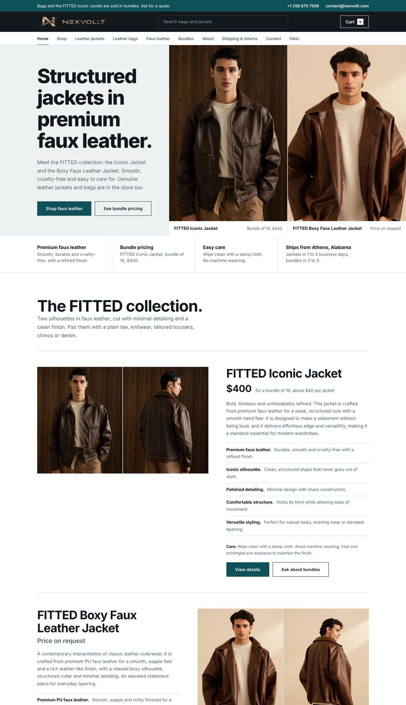
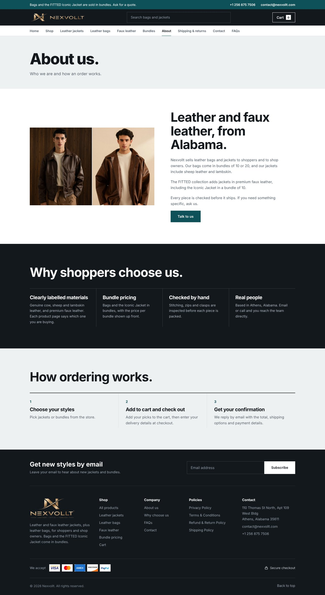
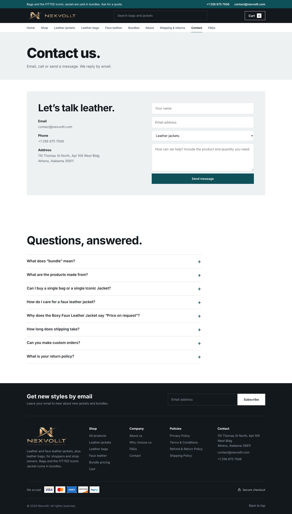
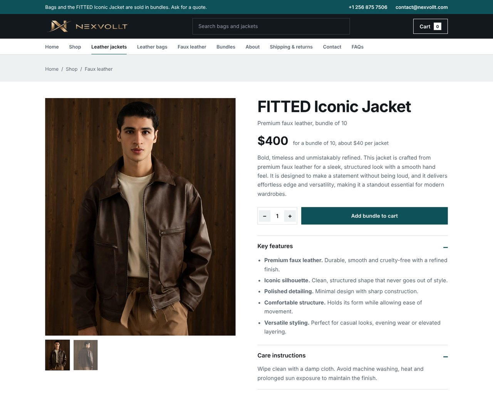
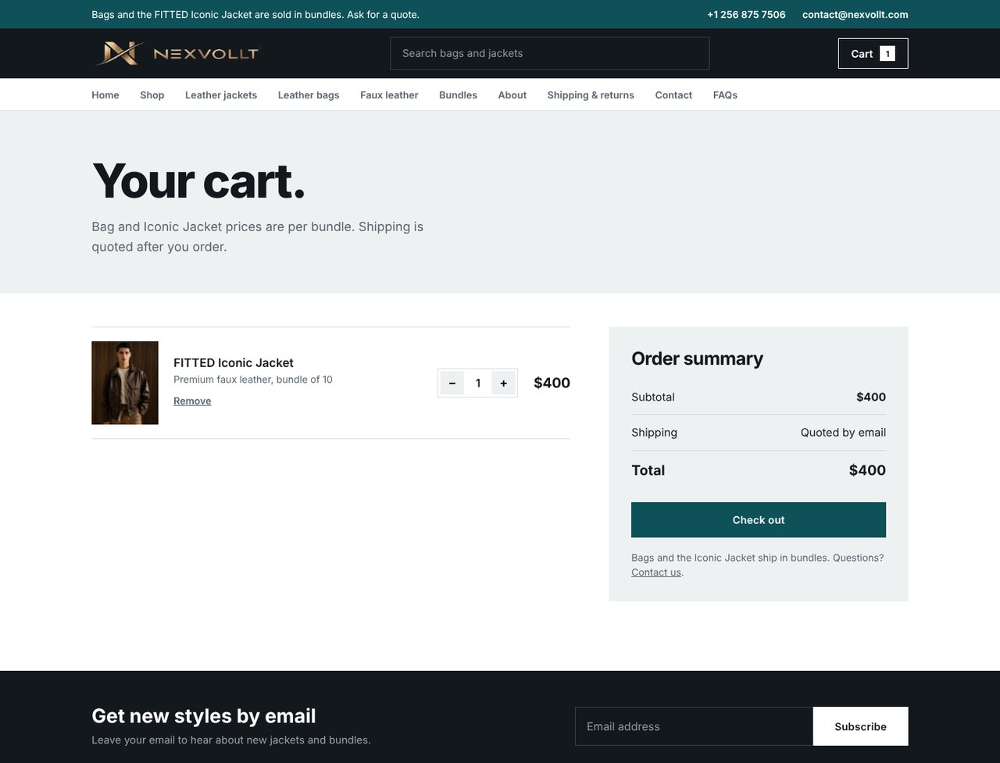
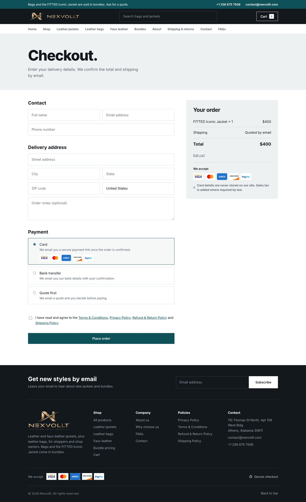
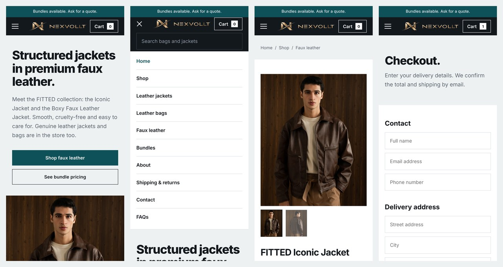

# Nexvollt

Online store for leather and faux leather jackets and leather bags. This is a static website built with plain HTML, CSS and JavaScript, so it needs no build step and no framework.

Nexvollt sells the **FITTED** faux leather jackets, genuine leather jackets (sheep leather and lambskin) and genuine leather bags. Bags and the FITTED Iconic Jacket are sold in bundles.

---

## Previews

### Home page
The hero shows the two FITTED jackets side by side. Below it are a facts strip, a detailed section for each FITTED jacket, shop by category, new products, bundle pricing, a materials guide, ordering steps, FAQs and the footer.



### About us page


### Contact us page
Includes the contact form and the full FAQ list. Product pages link here with the product name pre-filled.



### Single product page
Photo gallery with front and back views, price, features, care instructions, product details and related products.



### Cart page


### Checkout page
Contact details, delivery address, payment preference, terms agreement and an order summary.



### Mobile
The header collapses into a menu button, a centred logo and a cart button. The top bar shrinks to one short line. The menu opens as a full-width panel with search and large tap targets. Shown: home, open menu, product page and checkout.



---

## Pages

| File | Purpose |
|---|---|
| `index.html` | Home page |
| `shop.html` | All products with filters: Jackets, Bags, Faux leather. Supports `?f=` and `?q=` |
| `product-*.html` | One page per product (9 products) |
| `cart.html` | Cart with quantity controls |
| `checkout.html` | Checkout form |
| `about.html` | About us and how ordering works |
| `contact.html` | Contact form and FAQs |
| `shipping-policy.html`, `refund-and-return-policy.html`, `privacy-policy.html`, `terms-and-conditions.html` | Policies |

## Products

| Product | Material | Sold as | Price |
|---|---|---|---|
| FITTED Iconic Jacket | Premium faux leather | Bundle of 10 | $400 |
| FITTED Boxy Faux Leather Jacket | Premium PU faux leather | Contact us | Price on request |
| Brown Crocodile Texture Sheep Leather Jacket with Removable Fur | Sheep leather | Single | $120 |
| Two Tone Sheep Leather Jacket | Sheep leather | Single | $100 |
| Women's Cafe Racer Black Lambskin Leather Jacket | Lambskin | Single | $150 |
| Urban Crossbody Bag | Cow leather | Bundle of 10 | $250 |
| Signature Business Clutch | Cow leather | Bundle of 10 | $250 |
| Prestige Clutch | Full-grain cow leather | Bundle of 10 | $170 |
| Black Duo Crossbody Clutch | Cow leather | Bundle of 20 | $350 |

## Design

- **Style:** flat and minimal. Square corners, thin lines, no shadows and no 3D effects.
- **Colour:** white and cool greys, a graphite header and footer, and one petrol accent (`#0e5159`). The brown comes only from the product photography.
- **Type:** Archivo for headings and Hanken Grotesk for body text, loaded from Google Fonts with system fallbacks.
- **Motion:** one hero image reveal on page load, plus hover and click feedback. `prefers-reduced-motion` is respected.
- **Tokens:** all colours are CSS variables at the top of `assets/style.css`.

## Mobile responsiveness

- Breakpoints at 1000px, 700px, 560px and 380px.
- Below 1000px the header becomes a menu button, logo and cart. The menu closes on link tap and on `Esc`.
- Below 700px the top bar shows one short line and hides the phone and email, which stay in the footer and on the contact page.
- Search inputs use 16px text on mobile so iOS does not zoom in.
- Grids collapse from 4 to 2 to 1 columns, and buttons go full width on small screens.
- No horizontal scrolling was found at 390px on any page tested.

## Project structure

```
nexvollt/
├── index.html, shop.html, cart.html, checkout.html, about.html, contact.html
├── product-*.html          one page per product
├── *-policy.html, terms-and-conditions.html
├── assets/
│   ├── style.css           the whole design system
│   ├── app.js              product data, cart, header and menu behaviour
│   └── img/                logos, favicon and the four FITTED photos
└── docs/screenshots/       images used in this README
```

## Running locally

No install is needed. Open `index.html` in a browser, or serve the folder:

```
python3 -m http.server 8000
```

Then visit `http://localhost:8000`.

## Adding a product

1. Add the product images to `IM` in `assets/app.js`, as `[main image, second image]`.
2. Add one entry to `P` in the same file:

```js
["Name", "Short detail", 400, "jacket", "Description", "product-page.html", [], "Jacket", "faux"]
//  name   detail         price category description    page file          sizes tag      material
```

   Use `null` as the price to show "Price on request" and a quote button. The category is `"jacket"` or `"bag"`. The material is `"faux"` or `"genuine"`.
3. Duplicate an existing `product-*.html` file, update its text and change `const I=` to the new product's index in `P`.

The shop, home grid, cart and related products update automatically.

## Before going live

- **Orders are not sent anywhere.** Checkout saves the order in the visitor's browser (`localStorage`) and shows a confirmation. It does not email you, take payment or store orders on a server. Connect it to a backend or a service such as a payment provider or form handler before taking real orders.
- **Subscribe and contact forms:** the newsletter form only shows a thank-you message. The contact form opens the visitor's email app.
- **Hosted images:** the older products load their photos from `resilientmbss.com`. If that site changes or removes them, download them and place them in `assets/img/`.
- **Boxy Jacket price:** it is set to "Price on request" because no price was supplied. Set it in `assets/app.js` when you have one.
- **Check the policy pages** (shipping, returns, terms) apply to the FITTED jackets and to bundles.

## Content rules

All product copy comes from the supplied product data or the existing site. No reviews, ratings, sizes, stock levels or statistics have been invented. Each product page states whether the material is faux or genuine leather.
